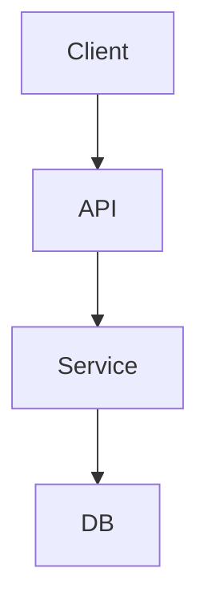
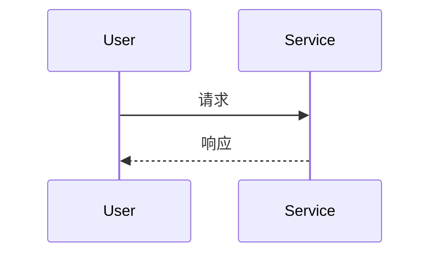

# <标题> — 设计

| 项 | 内容 |
|---|---|
| 状态 | 草稿 / 已采纳 / 已废弃 |
| 对应需求 | [[…-req]] |
| 更新日期 | YYYY-MM-DD |

## 1. 背景

- 要解决的问题：…
- 约束：…

## 2. 决策摘要

> 一句话：选定什么方案、解决什么问题。

## 3. 方案说明

### 结构 / 边界

- 读图要点：…

### 关键流程（按需）

### 接口 / 数据（按需）

| 名称 | 方向 | 要点 |
|---|---|---|
| … | in/out | 字段或契约摘要 |

## 4. 后果

| 类型 | 说明 |
|---|---|
| 收益 | … |
| 代价 / 后续 | … |

## 5. 备选方案

| 方案 | 结论 | 原因 |
|---|---|---|
| A | 未选 | … |
| B | 未选 | … |

## 6. 链接

| 类型 | 链接 |
|---|---|
| Requirement | [[…]] |
| Test | [[…]] |
