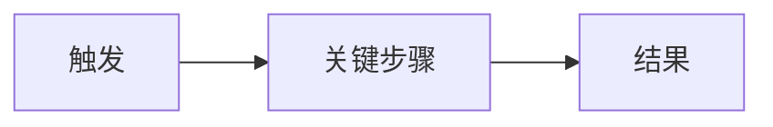

# <标题>

| 项 | 内容 |
|---|---|
| 状态 | 草稿 / 评审中 / 已定稿 |
| 优先级 | P0 / P1 / P2 |
| 负责人 | … |
| 更新日期 | YYYY-MM-DD |

## 1. 背景与目标

| 项 | 说明 |
|---|---|
| 背景 | 为何现在做（现状痛点，1～3 句） |
| 目标 | 一句话业务目标 |
| 成功标准 | 可度量的结果 |

## 2. 范围

| 类型 | 条目 |
|---|---|
| In | … |
| Out | … |

## 3. 角色与场景

| 角色 | 诉求 |
|---|---|
| … | … |

### 主流程

- 读图要点：…

### 场景列表

| ID | 场景 | 前置 | 主路径 | 异常 |
|---|---|---|---|---|
| S1 | … | … | … | … |

## 4. 功能要点

| ID | 能力 | 说明 | 优先级 |
|---|---|---|---|
| F1 | … | … | P0 |

## 5. 非功能（按需）

| 类别 | 要求 |
|---|---|
| 性能 / 安全 / 兼容 / 可运维 | … 或「无额外要求」 |

## 6. 验收标准

- [ ] …
- [ ] …

## 7. 依赖与风险

| 类型 | 说明 | 应对 |
|---|---|---|
| 依赖 | … | … |
| 风险 | … | … |

## 8. 链接

| 类型 | 链接 |
|---|---|
| Design | [[…]] |
| Test | [[…]] |
| Inventory | … |
