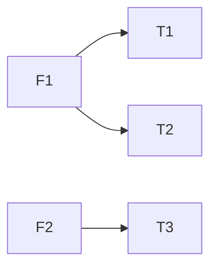

# <标题> — 测试

| 项 | 内容 |
|---|---|
| 状态 | 计划中 / 执行中 / 已完成 |
| 对应需求 | [[…-req]] |
| 对应设计 | [[…-design]] |
| 更新日期 | YYYY-MM-DD |

## 1. 范围与策略

| 项 | 说明 |
|---|---|
| 覆盖验收 | 列出对应 Acceptance ID / 条文 |
| 策略 | 单测 / 集成 / 手工 / E2E（勾选实际用到的） |
| 环境 | … |

### 覆盖关系（按需）



## 2. 用例

| ID | 用例 | 步骤 | 预期 | 结果 |
|---|---|---|---|---|
| T1 | … | 1. … 2. … | … | pass / fail / blocked / 未跑 |

## 3. 验证命令

```sh
# 仓库内最小验证命令（可复制）
```

## 4. 缺陷与风险

| ID | 问题 | 严重度 | 状态 | 说明 |
|---|---|---|---|---|
| D1 | … | 高/中/低 | open/fixed | … |

## 5. 结论

| 项 | 内容 |
|---|---|
| 是否可发布 | 是 / 否 / 有条件 |
| 残留风险 | … 或「无」 |

## 6. 链接

| 类型 | 链接 |
|---|---|
| Requirement | [[…]] |
| Design | [[…]] |
